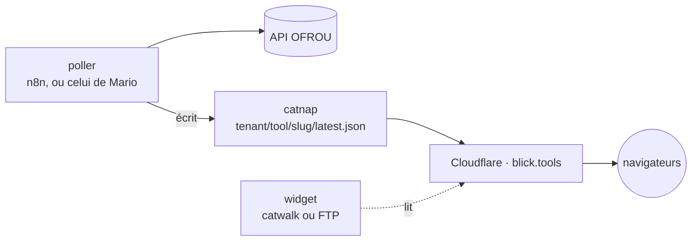

# Plan : données publiées sur la plateforme interne de Mario (catwalk / catnap) (13.10.2026)

Piste **non implémentée**, qui dépend des réponses de Mario, auteur du
[Blick-Stau-Radar](https://blick-stau-radar-tool.blick.tools/?lang=fr). Sa plateforme fait déjà ce qui manque au
prototype : un programme fait les relevés à heure fixe, publie de petits fichiers JSON, et Cloudflare les sert sous
`blick.tools`. Pour nous, ce serait 0 CHF et aucun serveur à entretenir *[à confirmer avec Mario]*.
Mêmes documents et même front que [PLAN-N8N-FIRESTORE.md](PLAN-N8N-FIRESTORE.md) (règles R1 à R4, § 12).
Les éléments marqués *[inférence]* sont déduits de ce que la plateforme renvoie, pas de son code.

## 1. Ce qu'on a observé (12.10.2026)

**catwalk**, hébergement des widgets :
- un sous-domaine par widget, `*.blick.tools`, derrière Cloudflare ;
- page : `cache-control: public, max-age=30, s-maxage=60, stale-while-revalidate=86400, stale-if-error=86400` ;
  fichiers JS/CSS : `max-age=31536000, immutable` ;
- intégration limitée à blick.ch et blick.tools (`content-security-policy: frame-ancestors 'self' https://*.blick.ch
  https://blick.ch https://*.blick.tools`) ;
- feuille de style du design Blick injectée (`/_catwalk/design/1/blick.css`) ; bandeau titre / source / pied
  modifiable par la rédaction (`GET https://deploy.blick.tools/api/v1/frames/<widget>` →
  `{"show":false,"blick_design":true}`) ;
- kit de compilation `@catwidgets/widget-kit`, qui ajoute `iframeHeightAdjustment.js` ;
- `deploy.blick.tools` répond « 404 page not found », message par défaut d'un serveur Go *[inférence]*.

**catnap**, données :
- `https://catnap.blick.tools/tenant/tool/<slug>/latest.json`, un fichier par axe (`gotthard` : 483 octets,
  `sanbernardino` : 358 octets) ; `history.json` et les autres axes testés : 404 ;
- `Access-Control-Allow-Origin: *` (lisible depuis n'importe quel site, y compris `localhost`) ;
- `Cache-Control: public, max-age=30, must-revalidate`, mais `cf-cache-status: DYNAMIC` : **le cache de Cloudflare
  n'est pas utilisé**, chaque lecture remonte au stockage ;
- `ETag` en MD5, `Accept-Ranges`, `Last-Modified` : stockage de fichiers de type R2 ou S3 *[inférence]* ;
- mis à jour **toutes les 10 min** à heure fixe (`fetched` de 13:40:08 à 13:50:08 UTC, observé 10 min) ;
  dates avec microsecondes et `+00:00` : programme en Python *[inférence]*.

**Le widget de Mario** relit toutes les 5 min (+ 0 à 30 s au hasard), abandonne après 15 s, espace les essais en
cas d'erreur, se met en pause quand l'onglet est caché, signale les données de plus de 25 min et garde les
dernières données en cas d'erreur. Ses messages viennent de Viasuisse (TCS, identifiants `TIC-Viasuisse`, absents
de notre flux OFROU). Sa fiche San Bernardino retient « Haag–Sennwald » (vallée du Rhin, ≈ 100 km du tunnel) :
filtre probablement limité au numéro de route.

## 2. Trois façons de s'en servir

| | C1. Notre poller publie sur catnap | C2. Le poller de Mario exécute notre code | C3. Lire son flux existant |
|---|---|---|---|
| Principe | le workflow n8n du plan Firestore, dont le dernier nœud écrit sur catnap au lieu de Firestore | notre relevé tourne à côté du sien | le widget lit `gotthard` et `sanbernardino` |
| Ce qu'il faut de Mario | un espace (« tenant ») et un moyen d'écrire | une place sur son infrastructure ; son code semble en Python, le nôtre en JS | rien (accord souhaitable) |
| Qui fait tourner le poller | nous (NAS, puis VPS ou n8n de l'entreprise) | Mario | Mario |
| Couverture | 4 traversées, compteurs, historique | idem | 2 axes, 10 min, sans compteurs ni historique, texte allemand |
| Effort pour nous | faible : un nœud n8n à changer, adaptateur `http` | moyen : empaqueter notre code selon ses contraintes | faible, mais le widget perd l'essentiel |
| Verdict | **la plus probable** | si Mario le propose | dépannage, ou complément Viasuisse |

## 3. Données

Les documents du plan Firestore (§ 4), en fichiers JSON : `now`, `{id}` (4), `history-{id}` (4), produits par
`buildDocuments`. Côté widget, adaptateur `http` et `config.json` (R2, R3) :
`{"source": "http", "base": "https://catnap.blick.tools/tenant/<tenant>/<tool>", "refresh_min": 10}`.

L'adresse observée ne montre qu'un fichier `latest.json` par `<slug>`. Si catnap n'accepte qu'un fichier par outil,
deux solutions : un `<slug>` par document (`traffic-now`, `traffic-gothard`, …), ou un seul document regroupant
`now` et les fiches (≈ 10 Ko), l'historique à part. À voir avec Mario.

## 4. Hébergement du widget

| | catwalk (`<widget>.blick.tools`) | hébergement FTP habituel |
|---|---|---|
| Adresse de l'iframe | sous-domaine de l'entreprise, stable : règle la question du nom de domaine | inchangée |
| Design Blick, bandeau rédaction | fournis | à notre charge (déjà fait dans le prototype) |
| Contraintes | compiler avec `@catwidgets/widget-kit` *[à confirmer]* ; intégration limitée à blick.ch | aucune nouvelle |
| Origine des données | même domaine que catnap | autre domaine : CORS déjà ouvert (`*`) |

Si le widget passe sur catwalk, l'iframe publiée pointant vers le FTP est à modifier : une seule intégration est
prévue (13.10.2026), donc une seule modification.

## 5. Volumes et coûts

Lectures par affichage et scénarios : comme le plan Firestore (§ 2), sans quota de lectures ni coupure. Les
fichiers sont petits (`now` ≈ 3 Ko, 0,5 Ko compressé). Coût pour nous : **0** *[à confirmer]* ; coût pour la
plateforme : lectures et bande passante de stockage tant que Cloudflare ne met pas `latest.json` en cache
(`DYNAMIC`). Une règle de cache côté Cloudflare suffirait ; à lui suggérer.

## 6. Questions à Mario

Message préparé : `scratch/message-mario.txt` (non versionné).
0. catwalk / catnap est-elle prévue pour d'autres équipes (rédaction romande) ? Mario serait-il d'accord de nous y
   accueillir pour plusieurs widgets de données (trafic, météo) ?
1. Où tourne son poller, qu'est-ce qui le déclenche ? Peut-on y faire tourner le nôtre (Node, toutes les 3 ou 10 min) ?
2. Peut-on avoir un espace sur catnap ? Comment écrit-on (API, authentification, format) ?
3. Un seul `latest.json` par outil, ou plusieurs fichiers ? Taille maximale ? Historique des versions ?
4. Les widgets d'autres équipes peuvent-ils être hébergés sur catwalk ? Faut-il le kit `@catwidgets/widget-kit` ?
5. Accès Viasuisse (TCS) : comment, sous quelle licence, réutilisable ?
6. Coût, responsable, et qui contacter pour l'accès ?
7. Surveillance : alerte si un poller s'arrête ? Quelle disponibilité attendre ?
8. Sur quoi tournent catwalk et le poller (VPS, conteneurs, autre) ?
9. À qui appartiennent le domaine `blick.tools` et les comptes derrière (entreprise ou personnel) ? Enregistré le
   28.01.2025 chez Name.com, expire le 28.01.2027, titulaire masqué.

## 7. Mise en place selon les réponses (C1)

1. Obtenir l'espace et le moyen d'écrire.
2. Workflow n8n du plan Firestore (§ 5) : remplacer les nœuds Firestore par des HTTP Request vers catnap ;
   l'historique se relit sur catnap au lieu de Firestore.
3. `config.json` du widget : source `http` vers catnap. Si le plan Firestore tourne déjà, c'est la seule modification
   côté widget, réversible en une minute.

## 8. Risques

| Risque | Effet | Parade |
|---|---|---|
| Plateforme d'une seule personne, sans contrat écrit | changement de format, d'adresse ou de priorités sans préavis | règle R3 : revenir à Firestore ou au VPS en changeant `config.json` |
| Pas de cache Cloudflare sur catnap | charge et coût pour la plateforme, pas pour nous | lui suggérer une règle de cache |
| Poller toujours sur le NAS (C1) | mêmes risques que dans le plan Firestore | poller sur un VPS ou un n8n de l'entreprise pour la production |
| Licence Viasuisse (si C3 ou complément) | republication non autorisée | vérifier avant toute réutilisation |
