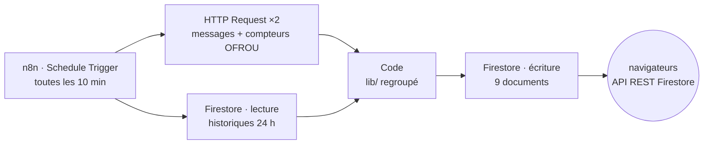

# Plan : relevés par n8n, données dans Firestore (13.10.2026)

Piste sérieuse, **non implémentée**. Elle remplace le serveur Express du prototype par un workflow n8n qui publie
l'état des traversées dans Firestore toutes les 10 min. Les navigateurs lisent Firestore directement. Objectif :
**0 CHF, sans carte bancaire** (plan Firebase Spark) et sans toucher au parsing (`lib/`).
Les éléments marqués *[hypothèse]* n'ont pas été vérifiés.



## 1. Pourquoi

- Le quota OFROU (260 000 appels sur 6 mois, 5/min) ne dépend que du rythme des relevés : 144 appels par jour et par
  API à 10 min, quelle que soit l'audience.
- Le problème restant est de servir les lectures des visiteurs gratuitement. Firestore Spark le fait jusqu'à
  50 000 lectures par jour, sans facture possible : au-delà, les lectures échouent.
- n8n tourne déjà (NAS personnel) : pas de Cloud Functions, donc pas de plan Blaze.
- 10 min : rythme du Blick-Stau-Radar (relevé à heure fixe toutes les 10 min, mesuré le 12.10.2026) ; un bouchon
  évolue sur des dizaines de minutes.

## 2. Volumes attendus

Statistiques du site (un mois, fournies le 13.10.2026) : 4,74 M pages vues, 152 800 par jour, ≈ 87 800 utilisateurs
par jour, sessions de 288 s pour 3,67 pages, soit **≈ 80 s par page**. Avec un rafraîchissement toutes les 10 min,
une page vue = **1 lecture** de `traffic/now`. Ouverture d'une fiche : 2 lectures de plus (fiche + historique),
pour 10 à 20 % des affichages *[hypothèse]*.

| Scénario | Affichages / jour | Lectures / jour (Spark : 50 000) | Sortie / mois (Spark : 10 Go) |
|---|---|---|---|
| S1 : quelques articles trafic | ≈ 2 000 | ≈ 2 600 ✅ | ≈ 0,4 Go ✅ |
| S2 : forte exposition (homepage un jour de pointe) | ≈ 20 000 | ≈ 26 000 ✅ | ≈ 3,8 Go ✅ |
| S3 : plafond théorique (chaque page du site) | 152 800 | ≈ 200 000 ❌ | ≈ 29 Go ❌ |

Sortie = lectures × taille des documents (§ 4), compression non comptée (on ignore si Firestore facture les octets
compressés). **Le plan tient en S1 et S2, pas en S3** : voir § 9.

## 3. Firestore, plan Spark

| Limite | Valeur | Conséquence |
|---|---|---|
| Lectures | 50 000 / jour | au-delà, les lectures échouent jusqu'à la remise à zéro |
| Écritures | 20 000 / jour | le workflow en fait 1 296 (§ 5) |
| Sortie réseau | 10 Go / mois | d'où des documents légers (§ 4) |
| Stockage | 1 Go | quelques dizaines de Ko utilisés |
| Taille d'un document | 1 Mo | `latest.json` (1,2 Mo) ne rentrerait pas : ne jamais y mettre tout le flux |
| Remise à zéro | minuit, heure du Pacifique | **9 h en Suisse** : un quota épuisé laisse le widget en erreur jusqu'au lendemain 9 h |

Source : [Firestore pricing](https://cloud.google.com/firestore/pricing) (consulté le 13.10.2026). Sur Spark, aucun
dépassement n'est facturé. Pour la région du projet, `europe-west6` (Zurich) ; elle est définitive une fois choisie.

## 4. Modèle de données

Chaque document contient un champ texte `json` (le contenu sérialisé) et `fetched_at`. Un seul champ texte évite au
navigateur de décoder le format typé de Firestore. Tailles mesurées le 13.10.2026 vers 9 h (journée calme) ; elles
croissent avec le nombre de messages.

| Document | Lu par | Contenu | Taille mesurée |
|---|---|---|---|
| `traffic/now` | chaque affichage | `fetched_at`, `publication_time`, `counters_at` ; par traversée : `id`, `level`, `pass` (`closed` + compteurs) ; par sens `S` / `N` : `level`, `queue_km`, `delay_min`, `delay_estimate`, `since`, compteurs (`site`, `main`, `speed_light`, `flow_light`, `flow_heavy`) | 3,0 Ko (0,5 Ko gzip) |
| `traffic/{id}` (4) | ouverture de la fiche | messages en cours par sens, sans sens, col ; `upcoming` (prochaines fermetures) ; **texte français seulement** | 0,1 à 3,4 Ko |
| `traffic/history-{id}` (4) | ouverture de la fiche | 24 h glissantes, une ligne par relevé et par sens : instant, `level`, `queue_km`, `delay_min`, vitesse et débit du compteur principal | ≈ 20 Ko *[hypothèse : 144 relevés × 2 sens]* |

Pour comparaison, `/api/now` fait aujourd'hui 15 Ko, dont 65 % pour `upcoming` et deux tiers des textes pour
l'allemand et l'italien. Les données fixes (`name`, `kind`, libellés des sens, noms des compteurs) ne sont plus
publiées : le front les tire de `lib/crossings.mjs` à la compilation. La fiche propose 6, 12 et 24 h ; le front
découpe le document de 24 h.

## 5. Workflow n8n

| Nœud | Réglage |
|---|---|
| Schedule Trigger | toutes les 10 min |
| HTTP Request « Messages » | POST `OTD_URL`, en-têtes `Content-Type: text/xml; charset=utf-8`, `SOAPAction: OTD_SOAP_ACTION` (constantes de `lib/otd-client.mjs`), identifiant *Header Auth* `Authorization: Bearer <OTD_API_KEY>`, réponse en texte, délai 60 s |
| HTTP Request « Compteurs » | idem avec `OTD_COUNTERS_URL`, `OTD_COUNTERS_SOAP_ACTION`, `OTD_COUNTERS_API_KEY` ; **On Error : Continue**, pour publier les messages même sans compteurs |
| Firestore « Get » ×4 | `traffic/history-{id}` ; un document absent = historique vide |
| Code | `lib/` regroupé (§ 6) : XML + historiques → 9 documents |
| Firestore « Create or Update » | les 9 documents ; identifiant compte de service (ou OAuth2, [doc n8n](https://docs.n8n.io/integrations/builtin/credentials/google/service-account)) |

Réglages du workflow :
- **Save successful executions : No.** Sinon n8n garde le XML (12 Mo) de chaque exécution dans sa base, soit
  ≈ 1,7 Go par jour. Garder les exécutions en échec.
- Fuseau `Europe/Zurich`, délai maximal 120 s.
- Optionnel : un *Error Workflow* qui prévient (mail, Telegram) après un échec.

Budget Firestore du workflow : 9 écritures + 4 lectures par passage, soit **1 296 écritures et 576 lectures par
jour** (sur 20 000 et 50 000).

Mémoire : l'analyse du XML de 12,5 Mo prend 0,44 s et monte à ≈ 270 Mo en Node (mesuré). Le NAS doit les avoir en
plus de n8n.

## 6. Faire entrer `lib/` dans le nœud Code

Le nœud Code n'accepte pas `import`, et `lib/` dépend de `fast-xml-parser`
([doc n8n](https://docs.n8n.io/hosting/configuration/configuration-examples/modules-in-code-node/)). Deux voies :

1. **Retenue : un script regroupé.** `npm run n8n` (à écrire) regroupe `lib/` + `fast-xml-parser` avec esbuild en un
   seul script autonome, à coller dans le nœud Code. Le même script écrit les deux corps SOAP à coller dans les nœuds
   HTTP Request : le corps « compteurs » dépend de `COUNTER_DETECTORS`. À refaire après chaque modification de `lib/`.
2. Installer `fast-xml-parser` dans l'image n8n et le déclarer dans `NODE_FUNCTION_ALLOW_EXTERNAL` (sur les Task
   Runners s'ils sont activés). Demande d'intervenir sur l'installation n8n.

Point d'entrée à ajouter dans `lib/` (fonction pure, testable avec `npm test`) :
`buildDocuments({ situationsXml, countersXml, histories, at })` → `{ now, details, histories }`. Elle appelle
`parseTrafficXml`, `parseMeasuredDataXml` et `summarizeCrossing`, réduit au contenu du § 4, ajoute le relevé aux
historiques et retire ce qui a plus de 24 h.

## 7. Firebase : mise en place (une fois)

1. Créer le projet `bl-iframe-traffic` (plan Spark), puis Firestore en `europe-west6`.
2. Règles de sécurité : lecture publique de `traffic/*`, aucune écriture depuis le navigateur. Le compte de service
   de n8n passe outre les règles.

   ```
   rules_version = '2';
   service cloud.firestore {
     match /databases/{database}/documents {
       match /traffic/{doc} {
         allow read: if true;
         allow write: if false;
       }
     }
   }
   ```
3. Paramètres du projet → Comptes de service → générer une clé ; la saisir dans l'identifiant n8n (e-mail du
   compte + clé privée), puis supprimer le fichier téléchargé.

## 8. Côté navigateur

- Le widget compilé reste sur l'hébergement FTP habituel : l'adresse des iframes ne dépend pas de la source des
  données (§ 12).
- Lecture sans SDK, via l'API REST (adaptateur `firestore`, § 12) :
  `GET https://firestore.googleapis.com/v1/projects/bl-iframe-traffic/databases/(default)/documents/traffic/now`
  → `JSON.parse(réponse.fields.json.stringValue)`.
- Relire à `fetched_at + 10 min` + 0 à 30 s au hasard, et non à intervalle fixe.
- Pause quand l'onglet est caché (`visibilitychange`).
- Garder les dernières données en cas d'erreur ; afficher l'heure du relevé ; signaler des données de plus de
  25 min (n8n ou NAS arrêté).
- Fiche : lire `traffic/{id}` et `traffic/history-{id}` à l'ouverture seulement.

## 9. Risques et parades

| Risque | Effet | Parade |
|---|---|---|
| Plus de 50 000 lectures dans la journée (S3, homepage permanente) | widget en erreur jusqu'à 9 h le lendemain | surveiller l'onglet Usage de Firebase ; au-delà de ≈ 40 000 / jour durables, passer en Blaze (≈ 4 $ / mois au plafond S3 : lectures + sortie réseau, sans plafond de dépense) ou au VPS ([PLAN-VPS.md](PLAN-VPS.md)) |
| Lectures publiques détournées par un script | épuise le quota du jour | App Check *[non évalué]* ; accepter le risque pour un prototype |
| NAS, connexion ou n8n arrêtés | données figées, pas d'erreur visible | âge des données affiché (§ 8), *Error Workflow* |
| Secrets de l'entreprise sur du matériel personnel | clé OTD et compte de service sur le NAS | pour la production, importer le workflow (export JSON) sur une instance n8n de l'entreprise |
| État figé au relevé | fermetures récurrentes (« nachts 22:00 bis 05:00 ») en retard de 10 min au plus | accepté |
| Documents qui grossissent un jour de crise | plus de sortie réseau | rester sur le texte français, ne publier que les traversées suivies |

## 10. Changements à faire dans le dépôt

- `lib/` : ajouter `buildDocuments` + tests ; le reste inchangé.
- `scripts/` : script de regroupement pour n8n (esbuild en dépendance de développement) + `npm run n8n`.
- `src/` : couche de données à deux adaptateurs choisis par `config.json` (§ 12), à la place de `/api/now` et
  `/api/history` ; données fixes depuis `lib/crossings.mjs` ; rafraîchissement du § 8 ; chemins relatifs
  (`base: "./"` dans `vite.config.js`) pour un hébergement en sous-dossier sur le FTP.
- `server/` : garder ; en cas de passage au VPS, il publie les mêmes documents (§ 12).
- README : procédure de publication.

## 11. Décisions ouvertes

- Rythme : 10 min (sobre) ou 3 min (comme le prototype) ; à 3 min, les écritures passent à ≈ 4 300 par jour, ce
  qui reste dans le quota.
- Propriétaire du projet Firebase : compte Google de l'entreprise plutôt que personnel.
- Hébergement de n8n en production (NAS personnel acceptable pour un pilote seulement).
- Archive complète (messages, compteurs) : abandonnée dans ce plan ; seules 24 h d'historique sont publiées.

## 12. Garder la sortie bon marché

Le plan est un point de départ : on peut passer au VPS ([PLAN-VPS.md](PLAN-VPS.md), § 11) ou à la plateforme de
Mario ([PLAN-CATNAP.md](PLAN-CATNAP.md)) si le besoin se fait sentir. Quatre règles, à appliquer dès maintenant,
rendent ce passage presque gratuit :

| Règle | Ce qu'elle évite |
|---|---|
| **R1. Un seul format de données.** `buildDocuments` (`lib/`) produit `now`, `{id}` et `history-{id}` ; n8n, le serveur du VPS et un éventuel publieur catnap l'appellent tous. | réécrire le front ou le parsing à chaque changement |
| **R2. Deux adaptateurs de lecture dans le front.** `firestore` (document `traffic/<clé>`, champ `json`) et `http` (fichier `<base>/<clé>.json`). | réécrire la couche de données (≈ ½ à 1 jour sans cette règle) |
| **R3. Source choisie à l'exécution.** Un `config.json` posé à côté du widget, non compilé : `{"source": "firestore", "project": "bl-iframe-traffic", "refresh_min": 10}` ou `{"source": "http", "base": "https://trafic.example.ch/feed", "refresh_min": 3}`. | recompiler et redéployer pour basculer ; revenir en arrière en une minute |
| **R4. Adresse du widget stable.** Le widget reste sur l'hébergement FTP (ou sous un nom que l'on contrôle) ; seule la source des données change. Poids faible : une seule intégration principale est prévue (13.10.2026), plus au plus une fiche `?point=…` ponctuelle et temporaire ; changer d'adresse revient à modifier une ou deux iframes. | modifier les iframes publiées |

Surcoût de ces règles par rapport au plan seul : ≈ 1 à 2 h *[estimation]*, l'adaptateur `http` et la lecture de
`config.json`. `buildDocuments` est de toute façon nécessaire au nœud Code.
