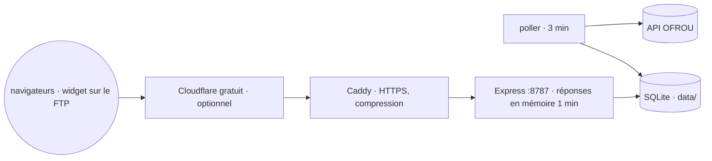

# Pegasus : comment le projet relève et sert ses données (état au 03.11.2026)

**Ce fichier ne documente que l'usage que `bl-iframe-traffic` fait du VPS Pegasus** : ce que le projet y installe,
comment la donnée OFROU y est relevée, mise en cache et servie au widget, et comment on le déploie. **La
documentation générale du serveur** (inventaire de ce qu'il héberge, accès SSH, système, réseau et pare-feux, Caddy
principal, surveillance, sauvegarde, capacité, ajout d'un autre projet, reconstruction) **est dans brain** :
`homelab/machines/pegasus/` du dépôt [brain](https://github.com/Citcatjoe/brain) (sur le Mac :
`~/Documents/___www/brain/homelab/machines/pegasus/README.md`). Toute information sur le serveur lui-même va là-bas,
pas ici (décision du 03.11.2026).

**En service depuis le 26.10.2026**, alternative retenue à [PLAN-N8N-FIRESTORE.md](PLAN-N8N-FIRESTORE.md). Pegasus
fait tourner le poller (toutes les 3 min), l'archive SQLite et l'API Express, avec Caddy devant pour le HTTPS ; le
widget est servi par le FTP de l'entreprise. Fichiers : [`deploy/bl-iframe-traffic.caddy`](deploy/bl-iframe-traffic.caddy),
[`deploy/bl-iframe-traffic.service`](deploy/bl-iframe-traffic.service), [`deploy/deploy.sh`](deploy/deploy.sh).
Les éléments marqués *[hypothèse]* n'ont pas été vérifiés.



## 1. Ce que le projet installe sur Pegasus

| | |
|---|---|
| Adresse publique | `https://trafic.citcatlab.ch` ; l'IP répond encore en HTTPS pendant la transition (§ 4) |
| Service | `bl-iframe-traffic.service` (systemd), utilisateur `traffic`, `/srv/bl-iframe-traffic`, port 8787 derrière Caddy |
| Données | `/srv/bl-iframe-traffic/data/` : `archive.sqlite` (+ WAL, 63 Mo le 03.11.2026, historique depuis le 08.10.2026), `latest.json` ; jamais touché par le déploiement |
| Secrets | `/srv/bl-iframe-traffic/.env` (clés OTD), `root:traffic`, 640 ; identifiants du compte OTD : gestionnaire de mots de passe de l'entreprise ([LICENCES.md](LICENCES.md) § 1) |
| Caddy | `/etc/caddy/sites/bl-iframe-traffic.caddy` (copie de `deploy/`), importé par le Caddyfile principal du serveur (brain) ; journal des requêtes `/var/log/caddy/trafic.log` |
| Ressources | ≈ 120 à 250 Mo de RAM selon le moment (pic pendant l'analyse XML), CPU < 1 % |
| Déployer | `deploy/deploy.sh` depuis le Mac, alias SSH `vps` (§ 6) |
| Widget | pas sur Pegasus : `npm run build`, puis `dist/` sur le FTP Blick |
| Journal | `ssh vps journalctl -u bl-iframe-traffic -f` |
| Contrôle | `curl -s https://trafic.citcatlab.ch/api/now \| head -c 300` (`fetched_at` de moins de 3 min) |
| Pas en place | sonde externe sur l'âge des données, sauvegarde de l'archive (§ 8) |

## 2. Pourquoi un VPS

| | n8n + Firestore (Spark) | VPS |
|---|---|---|
| Coût | 0 CHF, sans carte | 2,70 CHF / mois (+ nom de domaine, § 4) |
| Limite d'audience | 50 000 lectures / jour, coupure jusqu'à 9 h au-delà | aucune en pratique (§ 3) |
| Rythme / historique | 10 min / 24 h | 3 min / 7 jours, durée au choix (SQLite) |
| Code à changer | moyen : modèle de données, script pour n8n, couche de données du front | faible (§ 5) |
| Administration | Firebase + n8n sur le NAS | un serveur à entretenir, un nom DNS |
| Point faible | NAS personnel, quota, coupure à 9 h | pas de SLA |

Le VPS convient à tous les scénarios, y compris une homepage permanente.

Besoins mesurés du projet : analyse du XML OFROU en 0,44 s, ≈ 270 Mo de RAM au pic. Archive SQLite : 53 Mo
(fichier + WAL) pour 24 jours d'historique au 01.11.2026, soit ≈ 2 Mo par jour et ≈ 0,8 Go par an
*[extrapolation : croissance linéaire]*.

## 3. Charge

Statistiques du site (un mois) : 152 800 pages vues par jour, ≈ 80 s par page. Avec une relecture calée sur
`fetched_at + 3 min`, une page vue ≈ 1,4 lecture de `/api/now` ; la fiche ajoute `/api/history`
(10 à 20 % des affichages *[hypothèse]*).

| Scénario | Requêtes API / jour | Données API / jour (gzip) | Fichiers du widget / jour (≤ 0,6 Mo par premier affichage) |
|---|---|---|---|
| S1 : quelques articles | ≈ 3 000 | < 0,01 Go | ≤ 1,2 Go |
| S2 : forte exposition | ≈ 31 000 | ≈ 0,07 Go | ≤ 12 Go |
| S3 : plafond théorique | ≈ 236 000 (≈ 3 / s en moyenne) | ≈ 0,5 Go | ≤ 92 Go (≈ 9 Mb/s en moyenne) |

Tout tient dans 1 vCPU et 500 Mb/s, **à condition que `/api/now` soit calculé une fois par minute** et non à
chaque requête (§ 5). Les fichiers du widget (JS, CSS, police d'icônes, contours) dominent largement, mais ils sont
sur le FTP de Blick, pas sur Pegasus ; ils sont mis en cache un an par le navigateur (noms hachés). Les tuiles de
la carte viennent d'OpenFreeMap et ne passent pas par le VPS.

## 4. Adresse et HTTPS

Le widget est intégré en iframe dans des pages blick.ch servies en HTTPS. Les navigateurs **bloquent un appel
`http://` depuis une page `https://`** : l'API doit répondre en HTTPS.

| Adresse de l'API | Certificat | Coût | Limite |
|---|---|---|---|
| `https://203.0.113.10` (l'IP du VPS) | Let's Encrypt pour adresse IP, valable **6 jours**, renouvelé par Caddy (`profile shortlived`) | 0 | si le VPS change, l'IP change ; Cloudflare impossible ; un renouvellement raté se voit en quelques jours |
| `https://203-0-113-10.sslip.io` | Let's Encrypt classique | 0 | quota Let's Encrypt partagé par tous les utilisateurs de sslip.io ; service tiers ; mêmes limites que l'IP |
| `https://trafic.mondomaine.ch` (domaine à soi) | Let's Encrypt classique | ≈ 10 à 20 CHF / an *[à vérifier]* | aucune : changer de serveur = modifier un enregistrement DNS |
| `https://trafic.<domaine de l'entreprise>` | Let's Encrypt classique | 0 | demande à l'IT un enregistrement DNS A |

Sources : [Let's Encrypt, 15.01.2026](https://letsencrypt.org/2026/01/15/6day-and-ip-general-availability),
[sslip.io](https://sslip.io/).

**Retenu** : `https://trafic.citcatlab.ch` (domaine personnel, certificat obtenu le 26.10.2026). Raison : le filtre
Zscaler de l'entreprise bloque l'IP (403, « Miscellaneous or Unknown ») ; les postes derrière Zscaler, rédaction
comprise, voyaient donc le widget en erreur. Au 01.11.2026, depuis un poste derrière Zscaler, le domaine répond
(200, JSON) et l'IP reste bloquée. Le bloc de l'IP dans `deploy/bl-iframe-traffic.caddy` reste servi pour les
widgets compilés avant le domaine ; à retirer une fois la transition finie.

## 5. Relevé et cache : le chemin d'une donnée

Faits le 26.10.2026, complétés le 02.11.2026 :

1. **Relevé** : seul le poller de Pegasus appelle l'OFROU, toutes les 3 min par API (jamais moins de 2 min, y
   compris à travers les redémarrages), quel que soit le nombre de lecteurs. Chaque relevé va dans
   `data/archive.sqlite` ; le dernier, dans `data/latest.json` (écriture atomique) pour repartir après un
   redémarrage sans rappeler l'API.
2. **Calcul en mémoire** (`server/index.mjs`) : réponses de `/api/now` et `/api/history` gardées en mémoire (clé :
   minute courante, `fetched_at`, relevé compteurs, paramètres). Recalculées chaque minute, donc à jour pour les
   fermetures récurrentes.
3. **Cache HTTP** (`server/index.mjs`) : `Cache-Control: public, max-age=60, s-maxage=60, stale-while-revalidate=120,
   stale-if-error=86400` sur les réponses 200 de `/api/now` et `/api/history` ; jamais sur les erreurs. Prêt pour un
   CDN (§ 7).
4. **CORS** : `Access-Control-Allow-Origin: *` sur `/api/*` (données publiques, lecture seule).
5. **Compression** : faite par Caddy (`encode zstd gzip`), sans dépendance de plus.
6. **Widget** (`src/config/api.js`) : lit l'API à l'adresse `VITE_API_BASE` de `.env.production` (vide en
   développement : proxy Vite ; `npm run dev:vps` lit Pegasus). `npm run build` produit donc un widget pour le FTP
   qui lit Pegasus.
7. **Relecture** (`src/usePolling.js` / `src/App.jsx`) : 5 à 30 s (au hasard) après le prochain relevé annoncé par le
   serveur (`poller.*.next_poll`), nouvel essai après 20 s si le relevé est en retard, 60 s en cas d'erreur ;
   pause quand l'onglet est caché, relecture dès qu'il redevient visible ; `fetch(…, { cache: "no-cache" })` :
   le navigateur revalide toujours (304 si inchangé). Mesuré le 26.10.2026 : relevé à 13:03:14, widget à jour à
   13:03:23.
8. **Ce qui ne sort pas** (02.11.2026, conditions de l'OFROU, [LICENCES.md](LICENCES.md)) : `/api/messages` (flux
   parsé, debug) répond 404 si `NODE_ENV=production`, le cas du service ; seules sortent des données calculées pour
   dix points. Champ `source` des réponses : « Plateforme de données sur le trafic (PDT) OFROU ».

Reste à faire (03.11.2026) : avertissement dans le widget au-delà de 25 min sans nouveau relevé (aujourd'hui, seule
une erreur de l'API est signalée) ; relevé toutes les 2 min une fois le poller local arrêté (quota OFROU, § 6).

## 6. Déploiement

`deploy/deploy.sh` depuis le Mac (alias SSH `vps` ; accès et postes autorisés : brain). Il envoie le code du serveur
(`server/`, `lib/`, `deploy/`, `package*.json`) et le `.env` déchiffré par SSH (rien ne passe par GitHub, pas de clé
git-crypt sur le serveur), crée l'utilisateur `traffic` au besoin, lance `npm ci --omit=dev`, installe
`deploy/bl-iframe-traffic.service` et redémarre le service, puis installe `/etc/caddy/sites/bl-iframe-traffic.caddy`,
valide Caddy sous l'utilisateur `caddy` et le recharge. `data/` n'est jamais touché. Le script envoie l'arbre de
travail tel quel, commité ou non. Le widget ne passe pas par Pegasus : `npm run build`, puis publier `dist/` sur le
FTP.

```sh
deploy/deploy.sh                                   # mise en ligne
ssh vps journalctl -u bl-iframe-traffic -f         # journal en direct
curl -s https://trafic.citcatlab.ch/api/now | head -c 300
```

L'historique local (`data/archive.sqlite` depuis le 08.10.2026) a été copié avant le premier démarrage, avec
`sqlite3 data/archive.sqlite ".backup …"`, sans arrêter le serveur local.

**Quota OFROU** : un poller local et celui de Pegasus consomment chacun 480 appels par jour et par API, soit
172 800 sur 6 mois à eux deux (limite 260 000). Ça passe, mais le poller local est à arrêter (développement avec
`npm run dev:vps`). **Au 03.11.2026, le poller local tourne encore** (serveur de développement du Mac). Fin de
l'accès OTD vers le 08.04.2027 ([LICENCES.md](LICENCES.md) § 1).

## 7. Cloudflare (optionnel)

- Le domaine passe sur Cloudflare (plan gratuit), enregistrement A « proxied » vers le VPS.
- Règle de cache pour `/api/*` : Cloudflare ne met pas en cache par défaut les adresses sans extension. Il respecte
  ensuite le `Cache-Control` du § 5 : le VPS ne reçoit plus qu'environ une requête par minute et par point de
  présence, et `stale-if-error` garde le widget en vie si le VPS tombe.
- SSL/TLS en mode « Full (strict) » : Caddy garde son certificat.

## 8. Exploitation

Système, mises à jour, surveillance du serveur (`pegasus-monitor`) et procédures générales : brain. Propre au
projet :

| Tâche | Comment | État au 03.11.2026 |
|---|---|---|
| Surveiller | `pegasus-monitor` alerte si le service est arrêté ou en échec, pas si les données vieillissent. Manque : sonde externe sur `/api/now`, alerte si erreur ou si `fetched_at` a plus de 15 min | sonde externe pas en place |
| Journaux | `journalctl -u bl-iframe-traffic` (relevés, erreurs `AUTH`, `RATE_LIMIT`, `TIMEOUT`) ; requêtes : `/var/log/caddy/trafic.log` | en place |
| Sauvegarde | `sqlite3 data/archive.sqlite ".backup …"` régulier, copie hors du VPS (procédure manuelle : brain) | pas en place |
| Accès OTD | demander la prolongation vers mi-mars 2027 ([LICENCES.md](LICENCES.md) § 1) | à suivre |

## 9. Risques

| Risque | Effet | Parade |
|---|---|---|
| VPS ou Infomaniak indisponible (pas de SLA) | widget en erreur | Cloudflare + `stale-if-error` ; âge des données affiché ; VPS Cloud avec SLA pour la production |
| Accès OTD expiré | erreur `AUTH`, données figées sans alerte | prolongation avant le 08.04.2027 ; sonde sur l'âge des données |
| Renouvellement du certificat IP raté | HTTPS invalide en quelques jours pour les widgets compilés sur l'IP | retirer le bloc de l'IP après la transition |
| Pic d'audience extrême | CPU saturé si `/api/now` est recalculé à chaque requête | cache d'une minute (§ 5), Cloudflare |
| Secrets sur le serveur | clé OTD dans `.env` | utilisateur système dédié, `.env` en 640, seul Caddy exposé |

## 10. Décisions ouvertes

- ~~Adresse~~ : `trafic.citcatlab.ch` (domaine personnel, 26.10.2026) ; l'IP reste servie pendant la transition.
- ~~Widget~~ : sur le FTP de l'entreprise, Pegasus ne sert que l'API (décidé le 26.10.2026).
- Cloudflare devant, dès le départ ou au premier pic d'audience.

## 11. Venir du plan n8n + Firestore

Si l'on démarre avec [PLAN-N8N-FIRESTORE.md](PLAN-N8N-FIRESTORE.md) en appliquant ses règles R1 à R4 (§ 12), le
VPS ne sert pas l'API actuelle au widget : il **publie les mêmes documents** (`now`, `{id}`, `history-{id}`) en
fichiers, et le widget, resté sur le FTP, les lit avec son adaptateur `http`.

- Serveur : après chaque relevé, appeler `buildDocuments` et écrire les fichiers dans `data/public/` (fichier
  temporaire puis renommage, pour ne jamais servir un fichier à moitié écrit). L'historique 24 h se construit comme
  dans n8n, à partir du fichier précédent. Plus de calcul par requête : le cache d'une minute du § 5 devient inutile.
- Caddy : servir ces fichiers sous `/feed/` (le chemin `/data/` est déjà pris par les contours du widget), avec
  cache et CORS, avant le renvoi vers Node. Bloc validé avec `caddy adapt` et testé en local (Caddy 2.11.7) :

  ```
  (widget) {
  	encode zstd gzip
  	handle /feed/* {
  		root * /srv/bl-iframe-traffic/data/public
  		uri strip_prefix /feed
  		header Cache-Control "public, max-age=60, stale-while-revalidate=120, stale-if-error=86400"
  		header Access-Control-Allow-Origin "*"
  		file_server
  	}
  	handle {
  		reverse_proxy 127.0.0.1:8787
  	}
  }
  ```

| Étape | Travail *[estimation]* | Coût |
|---|---|---|
| Commander et installer le VPS (brain) | ½ jour | 2,70 CHF / mois dès la commande |
| Publication des fichiers par le serveur | 2 à 3 h, tests compris | – |
| Bloc `/feed/` dans le Caddyfile | 15 min | – |
| Nom DNS (optionnel, § 4) | une demande à l'IT, délai variable | 0 à 20 CHF / an |
| Marche en parallèle 24 h : n8n continue de servir, le VPS remplit son historique | – | quota OFROU : 144 + 480 appels par jour et par API, sans souci |
| Bascule : `config.json` sur le FTP passe à `{"source": "http", "base": "https://<IP ou nom>/feed", "refresh_min": 3}` | 1 min, retour arrière identique | – |
| Quelques jours plus tard : désactiver le workflow n8n ; garder le projet Firebase (gratuit) en secours ou le supprimer | 15 min | – |

**Total : ≈ 1 jour de travail, plus le délai DNS éventuel.** Aucune coupure. Ce qu'on perd : rien de visible ;
l'archive SQLite complète commence le jour du passage. Sans les règles R1 à R3, compter en plus ½ à 1 jour pour la
couche de données du front. Si le widget change d'adresse au passage : modifier l'iframe publiée.
